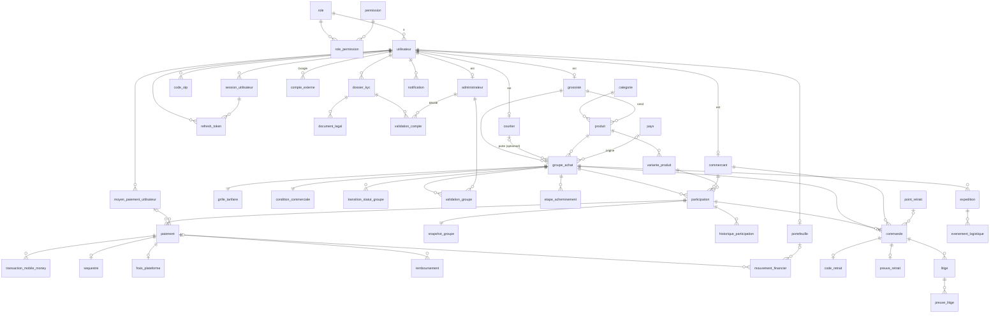
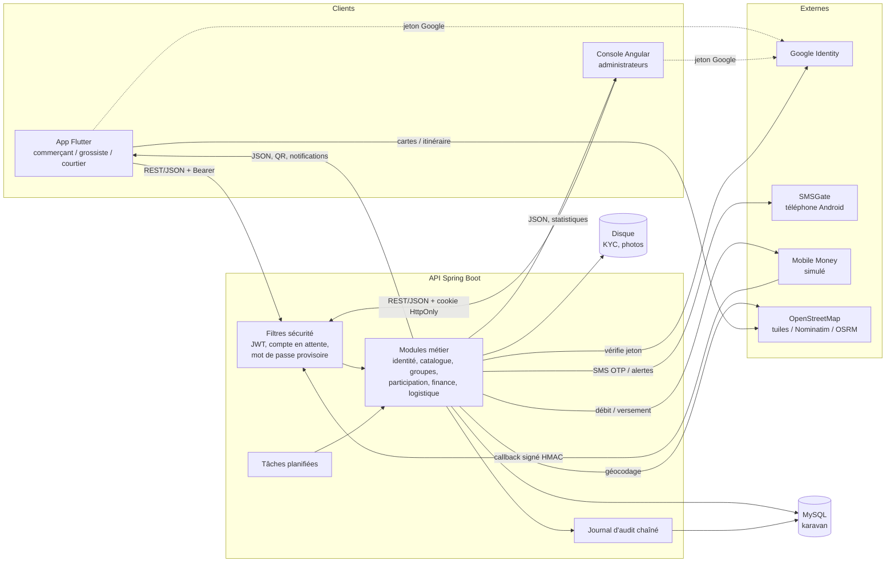

# Karavan — Dossier complet du projet

> Ce document décrit l'intégralité du projet **Karavan** à partir du code présent dans le dépôt (branche `salif`, état du 30 octobre 2026) et de l'historique Git. Il permet de comprendre le projet sans lire le code.
> Les points non confirmés par le code sont marqués **« à vérifier »**.
> Aucun mot de passe, aucune clé ni aucun secret ne figure dans ce document : seuls les **noms** des variables sont donnés.

---

## Sommaire

1. [Vue d'ensemble](#1-vue-densemble)
2. [Fonctionnalités](#2-fonctionnalités)
3. [API](#3-api)
4. [Base de données](#4-base-de-données)
5. [Flux de données](#5-flux-de-données)
6. [Configuration et lancement](#6-configuration-et-lancement)
7. [Historique et décisions](#7-historique-et-décisions)

---

## 1. Vue d'ensemble

### 1.1 But du projet

**Karavan** (ancien nom : **DoGo**) est une plateforme **B2B d'achats groupés** pour l'importation de marchandises vers le **Mali** (hub central : Bamako).

Principe :
1. Un **grossiste** (ou un **courtier**) monte un « groupe d'achat » sur un produit, avec une quantité cible, un prix unitaire tout compris et une date limite.
2. Un **administrateur** Karavan valide la publication du groupe.
3. Des **commerçants** réservent une quantité et paient par **Mobile Money**. L'argent est **bloqué en séquestre**.
4. Quand la quantité cible est atteinte, les commandes sont créées. La marchandise est acheminée jusqu'à un **dépôt / point de retrait** à Bamako.
5. Le commerçant retire sa commande avec un **QR code ou un code PIN**. Le séquestre est alors **libéré** vers le portefeuille du porteur du groupe, moins la commission de la plateforme.

### 1.2 À qui il sert

| Acteur | Rôle dans la plateforme | Application utilisée |
|---|---|---|
| **Commerçant** (`COMMERCANT`) | Acheteur (détail / demi-gros). Explore les groupes, réserve, paie, retire sa commande. | App Flutter |
| **Grossiste** (`GROSSISTE`) | Fournisseur. Gère son catalogue et son stock, valide la disponibilité, peut monter lui-même un groupe et l'acheminer. | App Flutter |
| **Courtier** (`COURTIER`) | Transitaire / importateur. Monte des groupes, gère le convoi et le dépôt, valide les retraits (scan QR), retire ses gains. | App Flutter |
| **Administrateur** (`ADMINISTRATEUR`) | Back-office : KYC, publication des groupes, réception au dépôt, remboursements, audit, gestion des comptes. Sous-fonctions : `TECHNIQUE`, `VALIDATION`, `FINANCE`, `SUPPORT`, `LOGISTIQUE`. | Console Angular |

### 1.3 Technologies

| Couche | Technologies | Détail |
|---|---|---|
| **Backend** | Java 25, Spring Boot 3.5.16, Maven | Web, Data JPA, Validation, Security, Actuator |
| Base de données | **MySQL 8**, **Flyway** (26 migrations) | Le schéma est géré uniquement par Flyway (`ddl-auto: none`) |
| Authentification | JWT (`jjwt` 0.12.6), sessions serveur, refresh token en cookie HttpOnly, BCrypt | Google Sign-In vérifié côté serveur (`google-api-client`) |
| Documentation API | springdoc-openapi 2.8.9 (Swagger UI) | `/swagger-ui.html` |
| Tests backend | JUnit 5, Spring Security Test, **ArchUnit** 1.4.1, Failsafe (tests d'intégration) | |
| **Console admin** | **Angular 22**, TypeScript 6, RxJS, Vitest | `globe.gl` + `three` (globe 3D), `jspdf` + `jspdf-autotable` (rapport PDF), `intl-tel-input` (indicatifs téléphoniques) |
| **App mobile / web** | **Flutter / Dart** (SDK ≥ 3.0) | `http`, `flutter_secure_storage`, `google_sign_in`, `flutter_map` + `latlong2` (cartes OSM), `geolocator`, `flutter_compass`, `mobile_scanner` (scan QR), `qr_flutter` (affichage QR), `image_picker`, `file_picker`, `webview_flutter` (planète 3D), `country_flags`, `url_launcher` |

**Services externes** (détail en section 3.3) : Google Identity (OAuth2 / OpenID Connect), passerelle SMS **SMSGate** (application Android), OpenStreetMap (tuiles, Nominatim, OSRM), Google Maps (liens), Mobile Money (Orange Money, Moov Money, Wave) **simulé**.

### 1.4 Organisation des dossiers

```text
karavan-project/
├── pom.xml                  POM Maven racine (module unique : karavan-backend)
├── README.md                Démarrage rapide
├── PROJET.md                Ce document
├── docs/                    Documentation transverse
│   ├── ARCHITECTURE.md      Architecture + diagrammes de séquence
│   ├── DECISIONS.md         Registre des décisions (ADR)
│   ├── GOOGLE_SETUP.md      Configuration Google Sign-In
│   ├── OBSERVATIONS.md      Points hors périmètre (ancien nom, ArchUnit, globe en test)
│   ├── db/rollback/         Scripts de retour arrière des migrations V21 à V26
│   ├── diagrams/            Diagrammes de classes et de cas d'utilisation (diagrams.net)
│   ├── images/              Design System
│   └── ressources_non_embarquees/  Ressources graphiques non intégrées aux apps
├── karavan-backend/         API Spring Boot
│   ├── docs/API.md          Liste des routes (partielle, voir 3.1)
│   ├── src/main/java/ml/dogo/   Code source (package historique « dogo »)
│   ├── src/main/resources/      application*.yml + db/migration (Flyway V1 → V26)
│   ├── src/test/                Tests unitaires, ArchUnit, intégration (FluxPrincipalIT)
│   ├── donnees/ , uploads/      Fichiers déposés (KYC, photos) — ignorés par Git
├── karavan-angular/         Console d'administration
│   └── src/app/
│       ├── core/            Auth, garde de routes, intercepteur HTTP, clients API, permissions
│       ├── pages/           Écrans (tableau de bord, KYC, groupes, finance, audit…)
│       ├── components/      Barre latérale, en-tête, modale code de sécurité, drapeaux
│       └── shared/          Styles partagés
├── karavan-flutter/         Application commerçant / grossiste / courtier
│   ├── lib/commercant/      Écrans du commerçant
│   ├── lib/grossiste/       Écrans du grossiste
│   ├── lib/courtier/        Écrans du courtier
│   ├── lib/screens/         Écrans communs (onboarding, détail groupe, paramètres, profil Google)
│   ├── lib/services/        Accès API (api/), session, Google, itinéraire, thème…
│   ├── lib/models/ , widgets/ , theme/ , utils/
│   ├── test/ , test_e2e/    Tests unitaires/widgets et parcours de bout en bout
│   └── android/ ios/ web/ windows/   Cibles de compilation
└── scratch/                 Scripts JS ponctuels et journaux de serveur (non applicatifs)
```

#### Modules du backend (`ml.dogo.*`) — monolithe modulaire

| Module | Responsabilité |
|---|---|
| `identite` | Inscription, OTP, connexion, sessions, refresh tokens, Google, KYC, profils, moyens de paiement, administrateurs, code de sécurité admin, support |
| `catalogue` | Catégories, produits, variantes (SKU, taille, couleur), stock, photos produits |
| `groupeachat` | Groupes d'achat, grille tarifaire, conditions commerciales, machine à états, pays d'origine, tableau de bord admin, étapes d'acheminement |
| `participation` | Réservations, participations, snapshot de prix, expiration, membres d'un groupe |
| `finance` | Paiements, callbacks Mobile Money, séquestre, portefeuille, mouvements, frais, remboursements |
| `logistique` | Commandes, points de retrait, convois/expéditions, codes de retrait, preuves, localisation |
| `litige` | Litiges et preuves (persistance + API interne seulement, pas de route HTTP propre) |
| `notification` | Notifications in-app et SMS (SMSGate ou simulation), relance |
| `audit` | Journal d'audit chaîné par hachage, en ajout seul |
| `shared` | Sécurité (JWT, filtres), configuration, erreurs, stockage de fichiers |
| `demo` | Jeu de données de démonstration (profil `demo` uniquement) |

Chaque module est découpé en couches `domain` (règles pures), `persistence` (JPA), `application` (cas d'usage), `web` (HTTP) et `api` (seule partie visible des autres modules). Le test **ArchUnit** `ArchitectureTest` fait respecter ces frontières (pas de cycle, pas d'accès direct `web → persistence`).

---

## 2. Fonctionnalités

### 2.1 Fonctionnalités réalisées

#### Identité et sécurité
| Fonctionnalité | Explication simple |
|---|---|
| Inscription par téléphone | Commerçant, grossiste ou courtier s'inscrit avec nom, téléphone et mot de passe. Le nom de boutique/société est optionnel (valeur par défaut générée). |
| Vérification OTP par SMS | Un code envoyé par SMS confirme le numéro (validité 2 min, 3 essais, nombre d'envois plafonné par numéro). |
| Activation selon le rôle | Le **commerçant** est actif dès la vérification du téléphone (exempté de KYC). **Grossiste et courtier** restent « en attente » jusqu'à la validation de leur dossier KYC. |
| Connexion | Téléphone + mot de passe. Verrouillage 15 min après 5 échecs. Message distinct « compte inexistant » / « mot de passe incorrect ». Refus si le compte appartient à un autre espace (rôle). |
| Sessions et jetons | Jeton d'accès JWT (30 min ; 15 min pour un admin) + refresh token (60 jours ; 7 jours pour un admin) avec rotation et détection de réutilisation. Session expirée après 30 jours d'inactivité. |
| Mot de passe oublié | Réinitialisation par code OTP SMS. |
| Connexion Google | Connexion / inscription via Google. Un nouveau compte Google doit fournir un téléphone malien vérifié par OTP ; si ce numéro existe déjà, le compte Google est rattaché (pas de doublon). |
| Profil | Modification du nom, langue, photo, nom de boutique/société, quartier, adresse, **coordonnées GPS** (carte OSM ou saisie manuelle). |
| Moyens de paiement | Ajout / suppression de numéros Mobile Money (Orange Money, Moov Money, Wave), un seul par défaut. |
| Dossier KYC | Dépôt de pièces (NIF, registre de commerce, licence de transit, pièce d'identité, relevé bancaire, autre) avec empreinte SHA-256 ; décision de l'admin (approuvé / rejeté avec motif). |
| Mot de passe provisoire | Les comptes admin créés (et l'admin principal) doivent changer leur mot de passe avant toute autre action. |
| Code de sécurité admin (4 chiffres) | Second facteur demandé avant chaque action sensible (KYC, suspension, notifications, création d'admin). |

#### Catalogue (grossiste)
| Fonctionnalité | Explication |
|---|---|
| Gestion des produits | Création / modification d'un produit (catégorie, description, pays d'origine, prix de gros indicatif, photo). |
| Variantes et stock | Variantes avec SKU unique, taille, couleur, quantité disponible (jamais négative). |
| Produits disponibles | Un courtier voit les produits des grossistes pour monter un groupe. |

#### Groupes d'achat
| Fonctionnalité | Explication |
|---|---|
| Création d'un groupe | Par un courtier ou directement par un grossiste. Quantité cible, date limite, coûts (marchandise, transport, douane, autres), délai de livraison, politique d'annulation, quantité minimale par commerçant, **pays d'origine obligatoire**. |
| Calcul du prix | Prix unitaire = marchandise + transport + frais plateforme (5 % de la marchandise) + douane + autres. |
| Cycle de vie | `BROUILLON → EN_VALIDATION → OUVERT → OBJECTIF_ATTEINT → EN_EXPEDITION → LIVRE → TERMINE`, ou `ANNULE` / `ECHOUE`. Chaque transition est historisée. |
| Validation de disponibilité | Le grossiste confirme que son stock couvre la cible. |
| Publication | L'administrateur approuve ou rejette la publication. |
| Expiration automatique | Une tâche planifiée (chaque minute) fait échouer les groupes dont la date limite est passée sans objectif atteint. |
| Annulation | Possible seulement avant l'objectif atteint ; déclenche les remboursements. |
| Étapes et incidents | Le grossiste signale des étapes d'acheminement et des incidents ; les admins sont notifiés. |
| Partage | Lien de partage d'un groupe (app Flutter). |

#### Participations, paiement et finance
| Fonctionnalité | Explication |
|---|---|
| Réservation | Le commerçant réserve une variante et une quantité : réservation valable **15 minutes**, quota protégé par mise à jour SQL atomique (impossible de dépasser la cible). |
| Snapshot de prix | Le prix et la cible sont figés au moment de la réservation. |
| Paiement | Paiement par Mobile Money ou par le portefeuille, avec clé d'idempotence (`Idempotency-Key`). |
| Callback opérateur | Le résultat de paiement arrive par un callback signé HMAC-SHA256, rejoué sans effet. **Simulé** en démo. |
| Séquestre | Chaque paiement réussi bloque les fonds en séquestre jusqu'au retrait validé, ou les restitue en cas d'échec/annulation. |
| Portefeuille | Solde bloqué / disponible, historique des mouvements, recharge, retrait des gains (courtier/grossiste). |
| Remboursements | Demande, approbation ou rejet par un administrateur finance. Motifs : annulation client, échec groupe, échec fournisseur, colis perdu, litige résolu. |
| Mouvements immuables | Les mouvements financiers ne peuvent être ni modifiés ni supprimés (triggers MySQL). |
| Tableau des séquestres | Vue admin des fonds bloqués. |

#### Logistique et retrait
| Fonctionnalité | Explication |
|---|---|
| Création des commandes | Automatique quand l'objectif du groupe est atteint (une commande par participation confirmée). |
| Avancement | Préparation → expédition → réception au dépôt (admin) → arrivée au point de retrait. |
| Convois | Création d'un convoi (expédition), événements de suivi, remise au transitaire, transit, arrivée, déclaration en douane. |
| Points de retrait | Gestion par l'admin (adresse, quartier, lien Google Maps). Conversion d'un lien Maps / Plus Code en coordonnées. |
| Code de retrait | À l'arrivée, chaque commande reçoit un QR (jeton unique) et un PIN haché, valable 7 jours, 3 essais. |
| Validation du retrait | Le courtier scanne le QR (ou saisit le PIN) : commande `COLLECTEE`, preuve enregistrée, séquestre libéré. |
| Itinéraire | L'app commerçant affiche l'itinéraire vers le dépôt (carte OSM, calcul d'itinéraire OSRM, boussole). |
| Suivi des colis | Écrans de suivi international pour commerçant et grossiste. |

#### Administration (console Angular)
| Écran | Contenu |
|---|---|
| Connexion / première connexion | Téléphone + mot de passe, Google ; changement obligatoire du mot de passe provisoire. |
| Tableau de bord `/admin` | **Globe 3D** (pays d'origine reliés à Bamako), **cadran 3D** des groupes, panneau de statistiques, tiroir de détail d'un groupe, assignation d'un pays aux anciens groupes, panneaux convois et utilisateurs, rapport PDF. |
| KYC | Dossiers en attente, consultation des pièces, décision. |
| Utilisateurs / Commerçants / Grossistes / Courtiers / fiche utilisateur | Listes, détails, suspension / réactivation, message au compte. |
| Groupes | Liste, détail, publication, membres d'un groupe. |
| Finance | Séquestres, remboursements. |
| Corridors | Vue par pays d'origine. |
| Retraits | Points de retrait et réception. |
| Administrateurs | Création d'administrateurs (réservée à la fonction `TECHNIQUE`), fonctions et permissions affichées. |
| Audit | Journal d'audit et vérification de l'intégrité de la chaîne. |
| Barre latérale | Rétractable (240 px / 72 px), état mémorisé localement. |

#### Transversal
| Fonctionnalité | Explication |
|---|---|
| Notifications | In-app + SMS, relance automatique des envois échoués (tâche chaque minute). |
| Journal d'audit | Chaque action sensible est tracée dans une chaîne de hachages (SHA-256) vérifiable. |
| Contact support | Coordonnées du support exposées publiquement (configurables). |
| Thème clair/sombre, didacticiel guidé | Dans l'app Flutter. |
| Multi-onglets web | L'app Flutter Web isole les sessions par onglet (sessionStorage) pour tester plusieurs rôles en parallèle. |

### 2.2 En cours ou non terminé

| Sujet | État |
|---|---|
| **Mobile Money réel** | Non branché : `PasserelleMobileMoneySimulee` écrit seulement dans les logs. Il faut écrire une implémentation de `PasserelleMobileMoney` par opérateur. |
| **SMS** | Branché sur **SMSGate** (smartphone Android de l'admin) avec repli sur simulation. Pas d'opérateur SMS professionnel. |
| **Litiges** | Tables et module présents, consultables par le support admin, mais **aucune route** pour ouvrir/résoudre un litige ni geler le séquestre (RG-61 à RG-64). |
| **Devises / corridor** | Table `taux_de_change` présente (CNY, USD, EUR → XOF) mais tout est calculé en XOF (RG-16, RG-42 non implémentés). |
| **Douane / convoi complet** | Routes de convoi présentes ; les règles détaillées RG-45 à RG-49 sont indiquées comme non implémentées dans le README backend — **à vérifier** au regard de `ConvoiService`. |
| **Avis / notation** | Colonnes `note_fiabilite` présentes, pas de fonctionnalité d'avis (RG-65). |
| Réconciliation opérateur, libération manuelle du séquestre | Non implémentées (RG-43, RG-39). |
| **Auth0** | Deux commits du 29/10 mentionnent une intégration Auth0 côté Flutter, mais **aucune trace d'Auth0 dans le code actuel** : retirée ou abandonnée — **à vérifier**. |
| Renommage DoGo → Karavan | Textes visibles et dossiers renommés ; restent `ml.dogo.*`, préfixes `dogo.*` dans la config, variables `DOGO_*`, cookie `dogo_refresh_token`. |
| Changements non commités | Au moment de la rédaction, le renommage `dogo-* → karavan-*`, la migration V26, la page Administrateurs et la première connexion sont **indexés mais pas commités**. |
| Tests d'intégration | `FluxPrincipalIT` (`mvn verify`) non exécuté lors du dernier audit ; démarrage complet sur vraie base « à vérifier ». |

### 2.3 Parcours utilisateur principaux

#### A. Inscription d'un commerçant (app Flutter)
1. Écran d'accueil (onboarding) → choix de l'espace **Commerçant**.
2. Saisie nom, téléphone (+223), mot de passe, confirmation → `POST /api/auth/inscription`.
3. Réception du SMS → saisie du code OTP → `POST /api/auth/verifier-otp` → compte **ACTIF**.
4. Connexion → accès à l'espace commerçant ; le didacticiel invite à configurer boutique et emplacement GPS dans **Paramètres**.

#### B. Inscription d'un grossiste ou d'un courtier
1. Inscription + OTP comme ci-dessus → compte **EN_ATTENTE**.
2. Dépôt du dossier KYC (pièces) → `POST /api/kyc`.
3. Tant que le compte est en attente, seules les routes de vérification sont accessibles (filtre `FiltreCompteEnAttente`).
4. L'administrateur valide le dossier dans la console → compte **ACTIF**.

#### C. Connexion avec Google
1. Bouton Google → jeton Google envoyé à `POST /api/auth/google`.
2. Compte connu → session ouverte.
3. Compte inconnu → statut `PROFIL_INCOMPLET` + jeton d'inscription temporaire (15 min).
4. Saisie du téléphone → `POST /api/auth/google/demander-otp` → saisie du code → `POST /api/auth/google/completer` → compte créé ou rattaché à un compte existant.

#### D. Cycle complet d'un groupe d'achat
1. **Grossiste** : crée un produit et ses variantes avec stock.
2. **Courtier** (ou grossiste) : crée le groupe (`POST /api/groupes`) puis le soumet (`/soumission`).
3. **Grossiste** : confirme la disponibilité du stock (`/disponibilite`).
4. **Admin** : approuve la publication → groupe `OUVERT`.
5. **Commerçant** : explore, rejoint (réservation 15 min), paie → participation `CONFIRMEE`, fonds en séquestre.
6. Objectif atteint → groupe `OBJECTIF_ATTEINT`, commandes créées.
7. **Courtier** : préparation → expédition ; **Admin** : réception au dépôt ; **Courtier** : arrivée au point de retrait → codes de retrait envoyés.
8. **Commerçant** : ouvre son QR ; **Courtier** : scanne → commande `COLLECTEE`, séquestre libéré vers son portefeuille (moins 5 %).
9. **Courtier** : retire ses gains depuis le portefeuille.

#### E. Première connexion d'un administrateur (console)
1. Connexion avec le mot de passe provisoire → redirection forcée vers `/premiere-connexion`.
2. Choix d'un mot de passe robuste (8–64 caractères, majuscule, minuscule, chiffre) → toutes les sessions sont fermées → reconnexion.
3. Configuration du code de sécurité à 4 chiffres (modale automatique).
4. Accès au tableau de bord selon sa fonction (permissions).

---

## 3. API

### 3.1 Généralités

- **Base** : `http://localhost:8080` en local. Toutes les routes métier commencent par `/api`.
- **Format** : JSON. Erreurs au format `application/problem+json` (`status`, `detail`, code métier, règle `RG-xx`).
- **Authentification** : en-tête `Authorization: Bearer <jeton>` obtenu à la connexion. Le refresh token est renvoyé dans le corps (mobile) et/ou dans le cookie HttpOnly `dogo_refresh_token` (web / console, en-tête `X-Client-Platform`).
- **Droits** : chaque route exige une **permission** (colonne « Auth »). « public » = sans jeton ; « connecté » = tout utilisateur authentifié.
- **Idempotence** : les paiements et retraits de portefeuille acceptent l'en-tête `Idempotency-Key`.
- **Documentation interactive** : Swagger sur `/swagger-ui.html`.
- Le fichier [karavan-backend/docs/API.md](karavan-backend/docs/API.md) est **incomplet** ; la liste ci-dessous est extraite des contrôleurs.

#### Permissions par rôle (données de référence V5 + V9 + V20)

| Rôle | Permissions |
|---|---|
| Commerçant | `PROFIL_GERER`, `KYC_SOUMETTRE`, `NOTIFICATION_LIRE`, `CAMPAGNE_EXPLORER`, `PARTICIPATION_GERER`, `PAIEMENT_EFFECTUER`, `COMMANDE_LIRE`, `RETRAIT_EFFECTUER`, `GROUPE_SUIVRE` |
| Grossiste | `PROFIL_GERER`, `KYC_SOUMETTRE`, `NOTIFICATION_LIRE`, `CATALOGUE_GERER`, `GROUPE_DISPONIBILITE_VALIDER`, `COMMANDE_LIRE`, `GROUPE_CREER`, `GROUPE_ANNULER`, `PORTEFEUILLE_RETIRER` |
| Courtier | `PROFIL_GERER`, `KYC_SOUMETTRE`, `NOTIFICATION_LIRE`, `CAMPAGNE_EXPLORER`, `GROUPE_CREER`, `GROUPE_SUIVRE`, `GROUPE_ANNULER`, `COMMANDE_LIRE`, `COMMANDE_AVANCER`, `RETRAIT_VALIDER`, `PORTEFEUILLE_RETIRER` |
| Admin `TECHNIQUE` | Toutes les permissions d'administration, dont `ADMIN_CREER` (seul à créer des admins) |
| Admin `VALIDATION` | KYC, publication et annulation de groupes, suivi |
| Admin `FINANCE` | Remboursements, portefeuille, suivi |
| Admin `SUPPORT` | Suspension de comptes, lecture des commandes, suivi |
| Admin `LOGISTIQUE` | Avancement des commandes, réception, points de retrait, validation des retraits |

> Les permissions d'un administrateur viennent de sa **fonction** (`AuthService.permissionsAdministratives`), pas de la table `role_permission`.

### 3.2 Endpoints

Légende des paramètres : `{id}` = identifiant dans l'URL ; *corps* = JSON envoyé ; *query* = paramètres d'URL.

#### Authentification — `/api/auth` (public)

| Méthode | URL | Rôle | Paramètres attendus | Auth |
|---|---|---|---|---|
| POST | `/api/auth/inscription` | Créer un compte (201) | corps : `type` (COMMERCANT/GROSSISTE/COURTIER), `telephone`, `nom`, `motDePasse`, champs optionnels du profil (`nomBoutique`, `quartierBamako`, `nomBoutiqueMarche`, `numeroNif`, `registreCommerce`, `nomSocieteImport`, `licenceTransit`, `adresseDepot`…) | public |
| POST | `/api/auth/renvoyer-otp` | Renvoyer le code SMS | corps : `telephone` | public |
| POST | `/api/auth/verifier-otp` | Valider le téléphone | corps : `telephone`, `code` | public |
| POST | `/api/auth/mot-de-passe-oublie/demande` | Envoyer un OTP de réinitialisation | corps : `telephone`, `typeActeur` (optionnel) | public |
| POST | `/api/auth/mot-de-passe-oublie/reinitialiser` | Changer le mot de passe par OTP | corps : `telephone`, `code`, `nouveauMotDePasse`, `typeActeur` | public |
| POST | `/api/auth/connexion` | Se connecter | corps : `telephone`, `motDePasse`, `deviceId`, `typeActeur` (espace attendu) | public |
| POST | `/api/auth/refresh` | Renouveler le jeton | corps : `refreshToken` (ou cookie), `deviceId` | public |
| POST | `/api/auth/logout` | Révoquer le refresh token (204) | corps ou cookie | public |
| POST | `/api/auth/google` | Connexion Google | corps : `idToken`, `deviceId`, `typeActeur`, `mode` | public |
| POST | `/api/auth/google/demander-otp` | OTP pour finaliser un compte Google | corps : `jetonInscription`, `telephone`, `typeActeur`… | public |
| POST | `/api/auth/google/completer` | Finaliser / rattacher un compte Google | corps : `jetonInscription`, `telephone`, `codeOtp`, `typeActeur`, `nomBoutique`, `quartierBamako`, `deviceId` | public |

Exemple de réponse de **connexion** :
```json
{
  "jeton": "<JWT>",
  "refreshToken": "<jeton opaque ou null côté web>",
  "expiration": "2026-10-30T15:30:00Z",
  "refreshExpiration": "2026-12-29T15:00:00Z",
  "profil": {
    "id": 12, "type": "COMMERCANT", "nom": "Awa Diarra", "telephone": "+223XXXXXXXX",
    "photoUrl": null, "statut": "ACTIF",
    "permissions": ["CAMPAGNE_EXPLORER", "PARTICIPATION_GERER", "..."],
    "motDePasseProvisoire": false
  }
}
```
Exemple de réponse d'**inscription / OTP** : `{ "utilisateurId": 12, "statut": "EN_ATTENTE", "codeOtp": null }` (`codeOtp` n'est rempli qu'en profil `demo`).

#### Profil — `/api/moi`

| Méthode | URL | Rôle | Paramètres | Auth |
|---|---|---|---|---|
| GET | `/api/moi` | Lire son profil complet | — | `PROFIL_GERER` |
| PATCH | `/api/moi` | Modifier son profil | corps : `nom`, `langue`, `photoUrl`, `nomBoutique`, `nomBoutiqueMarche`, `nomSocieteImport`, `quartierBamako`, `adresseLivraison`, `adresseDepot`, `latitude`, `longitude` (tous optionnels) | `PROFIL_GERER` |
| POST | `/api/moi/photo` | Envoyer une photo de profil | multipart : fichier | `PROFIL_GERER` |
| POST | `/api/moi/mot-de-passe` | Changer son mot de passe | corps : `ancienMotDePasse`, `nouveauMotDePasse` | `PROFIL_GERER` |
| POST | `/api/moi/deconnexion` | Fermer la session | — | connecté |
| GET | `/api/moi/moyens-paiement` | Lister ses numéros Mobile Money | — | `PROFIL_GERER` |
| POST | `/api/moi/moyens-paiement` | Ajouter un numéro | corps : `numero`, `operateur` (ORANGE_MONEY/MOOV_MONEY/WAVE), `parDefaut` | `PROFIL_GERER` |
| PUT | `/api/moi/moyens-paiement/{id}/defaut` | Définir par défaut | — | `PROFIL_GERER` |
| DELETE | `/api/moi/moyens-paiement/{id}` | Supprimer | — | `PROFIL_GERER` |

Réponse `GET /api/moi` : `{ "id", "type", "nom", "telephone", "langue", "statut", "photoUrl", "details": { …champs propres au rôle… } }`.

#### KYC

| Méthode | URL | Rôle | Paramètres | Auth |
|---|---|---|---|---|
| POST | `/api/kyc` | Soumettre un dossier | multipart : pièces par type | `KYC_SOUMETTRE` |
| GET | `/api/kyc/moi` | Voir son dossier | — | `KYC_SOUMETTRE` |
| GET | `/api/admin/kyc` | Dossiers en attente | — | `KYC_VALIDER` |
| POST | `/api/admin/kyc/{dossierId}/decision` | Approuver / rejeter | corps : `decision` (APPROUVE/REJETE), `commentaire` | `KYC_VALIDER` |
| POST | `/api/admin/kyc/utilisateurs/{utilisateurId}/validation` | Valider directement un compte | corps : `commentaire` | `KYC_VALIDER` |
| GET | `/api/admin/kyc/utilisateurs/{utilisateurId}` | Historique KYC d'un compte | — | `KYC_VALIDER` / `COMPTE_SUSPENDRE` / `AUDIT_LIRE` |
| GET | `/api/admin/kyc/{dossierId}/documents/{documentId}` | Télécharger une pièce (binaire) | — | `KYC_VALIDER` |

Réponse type (`DossierVue`) : `{ "id", "utilisateurId", "nom", "telephone", "typeActeur", "statut", "dateSoumission", "motifRejet", "documents": [...] }`.

#### Catalogue — `/api/catalogue`

| Méthode | URL | Rôle | Paramètres | Auth |
|---|---|---|---|---|
| GET | `/api/catalogue/categories` | Liste des catégories | — | public |
| GET | `/api/catalogue/produits-disponibles` | Produits proposés pour monter un groupe | — | `GROUPE_CREER` + `CAMPAGNE_EXPLORER` |
| GET | `/api/catalogue/produits` | Mes produits | — | `CATALOGUE_GERER` |
| POST | `/api/catalogue/produits` | Créer un produit | corps : `categorieId`, `nom`, `description`, `paysOrigine`, variantes, prix de gros, photo | `CATALOGUE_GERER` |
| PUT | `/api/catalogue/produits/{id}` | Modifier | corps : `nom`, `description`, `paysOrigine` | `CATALOGUE_GERER` |
| POST | `/api/catalogue/produits/{id}/variantes` | Ajouter une variante | corps : `sku`, `taille`, `couleur`, `qteDisponible` | `CATALOGUE_GERER` |
| PATCH | `/api/catalogue/variantes/{id}/stock` | Fixer le stock | corps : `qteDisponible` | `CATALOGUE_GERER` |
| POST | `/api/catalogue/upload-photo` | Envoyer une photo produit | multipart | `CATALOGUE_GERER` |

Réponse type (`ProduitVue`) : `{ "id", "categorieId", "nom", "description", "photoUrl", "paysOrigine", "variantes": [{ "id", "sku", "taille", "couleur", "qteDisponible" }], "prixGros" }`.

#### Groupes d'achat

| Méthode | URL | Rôle | Paramètres | Auth |
|---|---|---|---|---|
| GET | `/api/groupes` | Explorer les groupes ouverts | query : `categorieId` (optionnel)… | public (GET `/api/groupes/**` ouvert au niveau HTTP) |
| GET | `/api/groupes/{id}` | Détail d'un groupe | — | `CAMPAGNE_EXPLORER` / `GROUPE_SUIVRE` / `GROUPE_DISPONIBILITE_VALIDER` |
| GET | `/api/groupes/{id}/historique` | Historique des statuts | — | idem |
| GET | `/api/groupes/mes-groupes` | Groupes que j'ai créés | — | `GROUPE_CREER` |
| GET | `/api/groupes/a-valider` | Groupes à valider (grossiste) | — | `GROUPE_DISPONIBILITE_VALIDER` |
| GET | `/api/groupes/du-grossiste` | Groupes sur mes produits | — | `GROUPE_DISPONIBILITE_VALIDER` |
| POST | `/api/groupes` | Créer un groupe (201) | corps : `titre`, `produitId`, `quantiteCible`, `dateLimite`, `marchandise`, `transport`, `douane`, `autres`, `delaiLivraisonJours`, `politiqueAnnulation`, `quantiteMinParCommercant`, `paysOrigineCode` | `GROUPE_CREER` |
| PUT | `/api/groupes/{id}` | Modifier un brouillon | idem | `GROUPE_CREER` |
| POST | `/api/groupes/{id}/soumission` | Soumettre à validation | — | `GROUPE_CREER` |
| POST | `/api/groupes/{id}/disponibilite` | Confirmer le stock | — | `GROUPE_DISPONIBILITE_VALIDER` |
| POST | `/api/groupes/{id}/annulation` | Annuler | corps : `motif` | `GROUPE_ANNULER` |
| GET / POST | `/api/groupes/{id}/etapes` | Lire / signaler une étape d'acheminement | corps : `etape`, `commentaire` | lecture : grossiste ou admin ; écriture : `GROUPE_DISPONIBILITE_VALIDER` |
| POST | `/api/groupes/{id}/incident` | Signaler un incident | corps : `motif`, `detail`, `pieceJointeUrl` | `GROUPE_DISPONIBILITE_VALIDER` |
| GET | `/api/admin/groupes` | Tous les groupes | — | admin (plusieurs permissions) |
| GET | `/api/admin/groupes/en-validation` | Groupes à publier | — | `GROUPE_PUBLICATION_VALIDER` |
| POST | `/api/admin/groupes/{id}/publication` | Décider la publication | corps : `approuve`, `commentaire` | `GROUPE_PUBLICATION_VALIDER` |
| GET | `/api/admin/groupes/{groupeId}/membres` | Membres (commerçants) d'un groupe | — | rôle `ADMINISTRATEUR` |
| GET | `/api/pays` | Référentiel des pays | — | public |

Réponse type (`GroupeVue`) :
```json
{
  "id": 42, "titre": "Baskets Sport Homme", "statut": "OUVERT",
  "produit": { "id": 3, "nom": "...", "description": "...", "paysOrigine": "...", "categorie": "Chaussures", "photoUrl": "...", "variantes": [] },
  "courtier": { "id": 7, "nom": "..." }, "grossiste": { "id": 5, "nom": "..." }, "porteParGrossiste": false,
  "quantiteCible": 500, "quantiteConfirmee": 120, "quantiteReservee": 10, "quantiteRestante": 370,
  "prixUnitaire": 8400.00, "grille": { "...": "..." }, "conditions": { "...": "..." },
  "dateOuverture": "...", "dateLimite": "...", "disponibiliteValidee": true,
  "paysOrigineCode": "CN", "paysOrigineNom": "Chine"
}
```

#### Tableau de bord admin — `/api/admin/tableau-de-bord` (rôle `ADMINISTRATEUR` ou `AUDIT_LIRE`)

| Méthode | URL | Rôle |
|---|---|---|
| GET | `/resume` | Compteurs : utilisateurs, groupes par statut, répartition par pays, etc. |
| GET | `/groupes` | Groupes pour le cadran (query : filtres — détail **à vérifier**) |
| GET | `/groupes/{id}` | Détail complet d'un groupe (tiroir) |
| PUT | `/groupes/{id}/pays` | Assigner un pays d'origine (corps : `paysOrigineCode`, 2 lettres) |

#### Participations

| Méthode | URL | Rôle | Paramètres | Auth |
|---|---|---|---|---|
| POST | `/api/groupes/{groupeId}/participations` | Rejoindre (réserver 15 min) | corps : `varianteId`, `quantite` | `PARTICIPATION_GERER` |
| GET | `/api/moi/participations` | Mes participations | — | `PARTICIPATION_GERER` (ou admin) |
| GET | `/api/participations/{id}` | Détail | — | `PARTICIPATION_GERER` |
| GET | `/api/participations/{id}/historique` | Historique des statuts | — | `PARTICIPATION_GERER` |
| POST | `/api/participations/{id}/annulation` | Annuler | — | `PARTICIPATION_GERER` |

Réponse type : `{ "id", "groupeId", "produit", "sku", "taille", "couleur", "quantite", "statut", "prixUnitaire", "montant", "expirationReservation", "dateCreation", "photoUrl" }`.

#### Paiement, portefeuille, remboursements, séquestre

| Méthode | URL | Rôle | Paramètres | Auth |
|---|---|---|---|---|
| POST | `/api/participations/{id}/paiement` | Payer | en-tête `Idempotency-Key` ; corps : `moyenPaiementId`, `utiliserPortefeuille` | `PAIEMENT_EFFECTUER` |
| GET | `/api/participations/{id}/paiements` | Paiements d'une participation | — | `PAIEMENT_EFFECTUER` |
| POST | `/api/paiements/callback` | Callback opérateur Mobile Money | corps brut + signature HMAC (`X-Signature`) | public (signé) |
| GET | `/api/moi/portefeuille` | Soldes | — | connecté |
| GET | `/api/moi/portefeuille/mouvements` | Historique | query : taille | connecté |
| POST | `/api/moi/portefeuille/recharge` | Recharger | corps : `montant`, `operateur`, `numeroTelephone` | connecté |
| POST | `/api/moi/portefeuille/retraits` | Retirer ses gains | corps : `montant`, `moyenPaiementId` | `PORTEFEUILLE_RETIRER` |
| GET | `/api/moi/remboursements` | Mes remboursements | — | commerçant ou admin |
| GET | `/api/admin/remboursements` | Remboursements en attente | — | `REMBOURSEMENT_APPROUVER` |
| POST | `/api/admin/paiements/{paiementId}/remboursements` | Demander un remboursement | corps : `motif` | `REMBOURSEMENT_APPROUVER` |
| POST | `/api/admin/remboursements/{id}/approbation` | Approuver | — | `REMBOURSEMENT_APPROUVER` |
| POST | `/api/admin/remboursements/{id}/rejet` | Rejeter | corps : `justification` | `REMBOURSEMENT_APPROUVER` |
| GET | `/api/admin/finance/sequestres` | Tableau des séquestres | — | admin finance / audit |
| POST | `/api/dev/mobile-money/{paiementId}/succes` ou `/echec` | Simuler l'opérateur | — | profil `demo` uniquement, admin ou `PAIEMENT_EFFECTUER` |

Exemples : `PaiementVue` = `{ "id", "participationId", "montant", "montantRembourse", "statut", "dateInitiation" }` ; `PortefeuilleVue` = `{ "soldeBloque", "soldeDisponible", "devise": "XOF" }`.

#### Logistique, commandes, retraits

| Méthode | URL | Rôle | Paramètres | Auth |
|---|---|---|---|---|
| GET | `/api/points-retrait` | Lister les dépôts | — | connecté |
| POST / PUT | `/api/admin/points-retrait[/{id}]` | Créer / modifier un dépôt | corps : `nom`, `adresse`, `quartier`, `lienGoogleMap` | `POINT_RETRAIT_GERER` |
| GET | `/api/localisation` | Convertir un lien Maps / Plus Code / adresse en coordonnées | query : `lien`, `adresse` | connecté |
| GET | `/api/moi/commandes` | Mes commandes | — | `COMMANDE_LIRE` |
| GET | `/api/commandes/{id}` | Détail commande | — | `COMMANDE_LIRE` |
| GET | `/api/groupes/{groupeId}/commandes` | Commandes d'un groupe | — | `COMMANDE_LIRE` |
| POST | `/api/groupes/{groupeId}/preparation` | Marquer préparées | — | `COMMANDE_AVANCER` / `RECEPTION_VALIDER` |
| POST | `/api/groupes/{groupeId}/expedition` | Marquer expédiées | — | idem |
| POST | `/api/admin/groupes/{groupeId}/reception` | Réception au dépôt | — | `RECEPTION_VALIDER` |
| POST | `/api/groupes/{groupeId}/reception-point-retrait` | Arrivée au point → codes de retrait | corps : `pointRetraitId` | `COMMANDE_AVANCER` / `RECEPTION_VALIDER` |
| POST | `/api/admin/groupes/{groupeId}/notifier-depot` | Notifier l'arrivée au dépôt (lien GPS) | corps : `message` | `RECEPTION_VALIDER` |
| POST | `/api/groupes/{groupeId}/notifier` | Message aux acheteurs du groupe | corps : `message` | porteur du groupe |
| GET | `/api/commandes/{id}/code-retrait` | Obtenir son QR | — | `RETRAIT_EFFECTUER` |
| POST | `/api/commandes/{id}/code-retrait/regeneration` | Régénérer un code | — | `RETRAIT_VALIDER` |
| POST | `/api/retraits/valider` | Valider un retrait | corps : `qrToken` **ou** `commandeId` + `pin` | `RETRAIT_VALIDER` |
| GET | `/api/convois`, `/api/convois/{id}` | Lister / détail des convois | — | lecture commandes / suivi |
| POST | `/api/convois` | Créer un convoi | corps : `groupeId`, `reference`, `transporteur` | courtier / admin |
| POST | `/api/convois/{id}/evenements`, `/transitaire`, `/transit`, `/arrivee`, `/douane` | Étapes du convoi | corps : `statut`, `localisation` selon l'action | `COMMANDE_AVANCER` / `RECEPTION_VALIDER` |

Exemples : `CodeVue` = `{ "commandeId", "qrToken", "expiration", "tentativesRestantes", "bloque" }` ; `RetraitVue` = `{ "commandeId", "statut": "COLLECTEE", "date", "mode": "QR" }`.

#### Administration des comptes et support

| Méthode | URL | Rôle | Paramètres | Auth |
|---|---|---|---|---|
| POST | `/api/admin/comptes/{id}/suspension` | Suspendre | corps : `motif` | `COMPTE_SUSPENDRE` |
| POST | `/api/admin/comptes/{id}/reactivation` | Réactiver | — | `COMPTE_SUSPENDRE` |
| GET | `/api/admin/administrateurs` | Lister les admins | — | `ADMIN_CREER` |
| POST | `/api/admin/administrateurs` | Créer un admin (mot de passe provisoire) | corps : `telephone`, `nom`, `email`, `motDePasse`, `matricule`, `role` | `ADMIN_CREER` |
| GET | `/api/admin/fonctions-administratives` | Fonctions et permissions | — | `ADMIN_CREER` |
| GET | `/api/admin/commercants`, `/grossistes`, `/courtiers` | Listes de comptes | — | lecture des comptes (admin) |
| GET | `/api/admin/supervision/stats` | Statistiques de supervision | — | admin |
| GET | `/api/admin/securite/statut` | Code de sécurité configuré ? | — | rôle `ADMINISTRATEUR` |
| POST | `/api/admin/securite/configurer` | Définir / changer le code à 4 chiffres | corps : `nouveauCode`, `ancienCode`, `motDePasse` | rôle `ADMINISTRATEUR` |
| POST | `/api/admin/securite/verifier` | Vérifier le code avant une action sensible | corps : `code` | rôle `ADMINISTRATEUR` |
| POST | `/api/admin/support/message-utilisateur` | Message à un utilisateur | corps : `destinataireId`, `message` | support / technique |
| POST | `/api/admin/support/diffuser-admins` | Message à tous les admins | corps : `sujet`, `message` | support / technique |
| GET | `/api/admin/support/litiges` | Lister les litiges | — | support / finance |
| GET | `/api/admin/audit` | Dernières lignes d'audit | query : `taille` (défaut 50) | `AUDIT_LIRE` |
| GET | `/api/admin/audit/verification` | Vérifier la chaîne | — | `AUDIT_LIRE` |
| POST | `/api/dev/activer-compte/{id}` et `/api/dev/activer-compte-par-telephone/{telephone}` | Activer un compte (démo) | — | profil `demo`, `ADMIN_CREER` |

Exemple `GET /api/admin/audit/verification` : `{ "chaineIntacte": true, "lignesVerifiees": 1234, "premiereLigneFausse": null }`.

#### Notifications et divers

| Méthode | URL | Rôle | Auth |
|---|---|---|---|
| GET | `/api/moi/notifications` | Mes notifications | `NOTIFICATION_LIRE` |
| POST | `/api/moi/notifications/{id}/lue` | Marquer comme lue | `NOTIFICATION_LIRE` |
| GET | `/api/public/contact` | Coordonnées du support | public |
| GET | `/api/public/images/produits/**`, `/api/public/images/avatars/**` | Images (fichiers servis) | public |
| GET | `/actuator/health` | Santé du serveur | public |

### 3.3 API et services externes

| Service | Usage | Où | Variables / configuration nécessaires |
|---|---|---|---|
| **Google Identity** (OAuth2 / OIDC) | Connexion Google. Le backend vérifie la signature du jeton avec les clés publiques Google (cache automatique). | Backend, Flutter (`google_sign_in`), Angular (script `accounts.google.com/gsi/client`) | Backend : `GOOGLE_CLIENT_ID`. Flutter : `--dart-define=google_client_id=…`. Angular : identifiant **codé en dur** dans `pages/login/login.ts`. Voir [docs/GOOGLE_SETUP.md](docs/GOOGLE_SETUP.md). En profils `demo`/`local`/`test`, des jetons `mock-google-token:…` sont acceptés sans appel externe. |
| **SMSGate** (application Android sur le téléphone de l'admin) | Envoi réel des SMS (OTP, notifications) via la carte SIM, avec essai sur adresse locale puis publique, et repli sur simulation. | Backend (`PasserelleSmsGate`) | `SMSGATE_ACTIF`, `SMSGATE_LOCAL_URL`, `SMSGATE_PUBLIC_URL`, `SMSGATE_USERNAME`, `SMSGATE_PASSWORD`, `SMSGATE_DEVICE_ID`, `SMSGATE_SIM_NUMBER` |
| **Mobile Money** (Orange Money, Moov Money, Wave) | Débit, remboursement, versement. **Simulé** : rien n'est réellement débité. | Backend (`PasserelleMobileMoney`) | `DOGO_MM_SECRET` (secret HMAC de signature des callbacks) |
| **OpenStreetMap — tuiles** | Fond de carte | Flutter (`flutter_map`) | aucune clé |
| **Nominatim** (OSM) | Géocodage d'une adresse en coordonnées | Backend (`LocalisationService`) et Flutter | aucune clé (respecter les conditions d'usage) |
| **OSRM** (`router.project-osrm.org`, `routing.openstreetmap.de`) | Calcul d'itinéraire vers le dépôt | Flutter (`itineraire_service`) | aucune clé |
| **Google Maps** (liens) | Liens vers les dépôts ; le backend déroule les liens courts `maps.app.goo.gl` | Backend, Flutter | aucune clé |
| **Google Fonts** | Polices de la console | Angular | aucune clé |
| WhatsApp (`wa.me`) | Lien de contact support | Flutter | `DOGO_SUPPORT_WHATSAPP` |

---

## 4. Base de données

### 4.1 Type et connexion

- **MySQL 8**, moteur InnoDB, jeu de caractères `utf8mb4`. Base `karavan` (base de test d'intégration : `karavan_test` d'après le commit `15cdf25` ; le README backend parle encore de `dogo_test` — **à vérifier**).
- Connexion JDBC via `DB_URL`, `DB_USER`, `DB_PASSWORD`. En profil `local`, des valeurs par défaut pointent vers `localhost:3306/karavan`.
- Pool Hikari en isolation **READ COMMITTED**. Dates en UTC.
- Schéma créé et versionné **uniquement par Flyway** (`karavan-backend/src/main/resources/db/migration`, V1 → V26). Les scripts de retour arrière V21 → V26 sont dans `docs/db/rollback/`.
- Le compte MySQL doit avoir le droit `TRIGGER` (triggers d'immuabilité).
- Conventions : montants `DECIMAL(15,2)` en XOF, dates `DATETIME(3)`, statuts contraints par `CHECK`.

### 4.2 Tables

> PK = clé primaire, FK = clé étrangère, UQ = unicité.

#### Identité

**`role`** — rôles applicatifs (COMMERCANT, GROSSISTE, COURTIER, ADMINISTRATEUR)
| Champ | Type | Clé |
|---|---|---|
| id | BIGINT auto | PK |
| nom | VARCHAR(40) | UQ |
| description | VARCHAR(255) | |

**`permission`** — permissions fines : `id` BIGINT PK, `code` VARCHAR(60) UQ, `description`.

**`role_permission`** — liaison N–N : `role_id` FK→role, `permission_id` FK→permission (PK composée).

**`utilisateur`** — compte de toute personne
| Champ | Type | Clé / contrainte |
|---|---|---|
| id | BIGINT auto | PK |
| type_acteur | VARCHAR(20) | COMMERCANT / GROSSISTE / COURTIER / ADMINISTRATEUR |
| telephone | VARCHAR(20) | UQ |
| nom | VARCHAR(120) | |
| email | VARCHAR(255) | nullable (V21) |
| mot_de_passe_hash | VARCHAR(255) | BCrypt, nullable (comptes Google) |
| mot_de_passe_provisoire | TINYINT(1) | V26 |
| langue | VARCHAR(5) | défaut `fr` |
| photo_url | VARCHAR(500) | V13 |
| statut_compte | VARCHAR(20) | EN_ATTENTE / ACTIF / SUSPENDU / DESACTIVE |
| telephone_verifie | BOOLEAN | |
| tentatives_echecs | INT | ≥ 0 |
| verrouille_jusqua | DATETIME(3) | |
| role_id | BIGINT | FK→role |
| date_creation | DATETIME(3) | |

**`commercant`** (1–1 avec utilisateur) : `utilisateur_id` PK+FK, `nom_boutique`, `adresse_livraison`, `quartier_bamako`, `canal_vente`, `latitude`, `longitude`.

**`grossiste`** (1–1) : `utilisateur_id` PK+FK, `nom_boutique_marche`, `numero_nif`, `registre_commerce`, `note_fiabilite` DECIMAL(3,2) 0–5, `latitude`, `longitude`, `quartier_marche`.

**`courtier`** (1–1) : `utilisateur_id` PK+FK, `nom_societe_import`, `licence_transit`, `adresse_depot`, `note_fiabilite`, `latitude`, `longitude`.

**`administrateur`** (1–1) : `utilisateur_id` PK+FK, `matricule_agent` UQ, `role_administratif` (VALIDATION / FINANCE / SUPPORT / LOGISTIQUE / TECHNIQUE), `code_securite_hash` (BCrypt), `code_securite_date`.

**`code_otp`** — codes SMS : `id` PK, `utilisateur_id` FK nullable (ON DELETE SET NULL), `telephone`, `code_hash`, `expiration`, `tentatives`, `utilise`, `date_creation`.

**`session_utilisateur`** — sessions : `id` PK, `utilisateur_id` FK, `device_id`, `ip`, `empreinte`, `date_creation`, `derniere_activite`, `date_expiration`, `invalidee`.

**`refresh_token`** : `id` PK, `token_hash` (SHA, UQ), `utilisateur_id` FK (CASCADE), `session_id` FK (SET NULL), `device_id`, `ip_creation`, `date_expiration`, `revoque`, `date_revocation`, `remplace_par_hash`, `derniere_utilisation`, `date_creation`.

**`compte_externe`** — liaison Google : `id` PK, `fournisseur` (GOOGLE), `sub`, `utilisateur_id` FK (CASCADE), `email`, `cree_le` ; UQ(`fournisseur`, `sub`).

**`moyen_paiement_utilisateur`** : `id` PK, `utilisateur_id` FK, `numero_mobile_money`, `operateur` (ORANGE_MONEY/MOOV_MONEY/WAVE), `par_defaut`, `cle_defaut` (colonne générée garantissant un seul défaut) ; UQ(`utilisateur_id`, `numero_mobile_money`).

**`dossier_kyc`** : `id` PK, `utilisateur_id` FK, `statut` (EN_ATTENTE/APPROUVE/REJETE), `date_soumission`, `motif_rejet` (obligatoire si rejeté).

**`document_legal`** : `id` PK, `dossier_id` FK, `type` (NIF, REGISTRE_COMMERCE, LICENCE_TRANSIT, PIECE_IDENTITE, RELEVE_BANCAIRE, AUTRE), `fichier` (chemin disque), `empreinte_sha256`, `date_expiration`.

**`validation_compte`** — décisions KYC : `id` PK, `dossier_id` FK, `administrateur_id` FK nullable, `decision`, `date_decision`, `commentaire`.

#### Catalogue

**`categorie`** : `id` PK, `nom_categorie` UQ, `description`, `active`.

**`produit`** : `id` PK, `grossiste_id` FK→grossiste, `categorie_id` FK, `nom_produit`, `description` TEXT, `photo_url`, `pays_origine` (texte libre), `prix_gros`.

**`variante_produit`** : `id` PK, `produit_id` FK, `sku` UQ, `taille`, `couleur`, `qte_disponible` (≥ 0).

#### Groupes d'achat

**`groupe_achat`**
| Champ | Type | Clé / contrainte |
|---|---|---|
| id | BIGINT | PK |
| courtier_id | BIGINT | FK→courtier, **nullable** (NULL = groupe porté par le grossiste) |
| grossiste_id | BIGINT | FK→grossiste |
| produit_id | BIGINT | FK→produit |
| titre | VARCHAR(120) | |
| quantite_cible / _confirmee / _reservee | INT | confirmée + réservée ≤ cible |
| prix_unitaire | DECIMAL(15,2) | > 0 |
| date_ouverture, date_limite | DATETIME(3) | limite > ouverture |
| statut | VARCHAR(20) | 9 statuts (voir 2.1) |
| disponibilite_validee | BOOLEAN | |
| version | BIGINT | verrou optimiste |
| pays_origine_code | VARCHAR(2) | FK→pays |

**`grille_tarifaire`** (1–1 avec groupe) : `prix_marchandise`, `transport`, `frais_plateforme`, `douane`, `autres`, `devise` (XOF), `taux_commission`.

**`condition_commerciale`** (1–1) : `delai_livraison_jours`, `politique_annulation`, `quantite_min_par_commercant`.

**`transition_statut_groupe`** : historique `ancien_statut`, `nouveau_statut`, `date_transition`, `auteur`.

**`validation_groupe`** : décision de publication (`administrateur_id` nullable, `decision`, `commentaire`).

**`etape_acheminement`** : `groupe_id` FK, `etape`, `commentaire`, `date_signalee`, `auteur_id` (sans FK).

**`pays`** : `code_iso` PK (2 lettres), `code_iso_3` UQ, `nom_fr`, `latitude`, `longitude`, `actif`.

#### Participation et finance

**`participation`** : `id` PK, `groupe_id` FK, `commercant_id` FK→commercant, `variante_id` FK, `quantite_demandee`, `statut` (DEMANDEE/RESERVEE/CONFIRMEE/ANNULEE/EXPIREE), `date_creation`, `date_expiration_reservation`, `cle_active` (générée : une seule participation active par commerçant/groupe/variante).

**`snapshot_groupe`** (1–1 avec participation) : `produit_fige`, `prix_fige`, `frais_unitaire_fige`, `quantite_cible_figee`, `date_fige`.

**`historique_participation`** : `participation_id` FK, `ancien_statut`, `nouveau_statut`, `date_evenement`.

**`paiement`** : `id` PK, `participation_id` FK, `moyen_paiement_id` FK nullable (paiement par portefeuille), `montant`, `montant_rembourse`, `statut` (INITIE/EN_ATTENTE/PAYE/ECHOUE/EXPIRE/REMBOURSE), `cle_idempotence` UQ, `date_initiation`, `date_maj`, `cle_vivante` (un seul paiement actif par participation).

**`transaction_mobile_money`** : `paiement_id` FK, `tx_id` UQ, `operateur`, `callback_brut` TEXT, `date_callback`.

**`sequestre`** (1–1 avec paiement) : `montant_bloque`, `statut` (BLOQUE/LIBERE/RESTITUE), `gele`, `date_blocage`, `date_liberation`.

**`portefeuille`** : `id` PK, `courtier_id` (nom historique ; FK→**utilisateur** depuis V9, UQ), `solde_bloque`, `solde_disponible` (≥ 0), `devise`.

**`mouvement_financier`** — **immuable** (triggers) : `paiement_id` FK, `portefeuille_id` FK, `type` (DEBIT_COMMERCANT, BLOCAGE_SEQUESTRE, LIBERATION_SEQUESTRE, FRAIS_PLATEFORME, REMBOURSEMENT, RETRAIT_COURTIER, RECHARGE_PORTEFEUILLE), `montant`, `date_mouvement`, `reference` UQ.

**`frais_plateforme`** (1–1 avec paiement) : `montant`, `taux_commission`, `date_prelevement`.

**`remboursement`** : `paiement_id` FK, `montant`, `statut` (DEMANDE/APPROUVE/REJETE/EXECUTE), `motif`, `approuve_par`, `date_demande`, `date_maj`.

**`taux_de_change`** : `devise_source`, `devise_cible`, `taux`, `date_mise_a_jour` (non utilisé dans les calculs).

#### Logistique, litiges, transversal

**`point_retrait`** : `id` PK, `nom`, `adresse`, `quartier`, `lien_google_map`.

**`commande`** : `participation_id` FK UQ, `groupe_id` FK, `commercant_id` FK, `point_retrait_id` FK, `quantite`, `statut` (CREEE, PREPAREE, EXPEDIEE, ARRIVEE, EN_ATTENTE_RETRAIT, COLLECTEE, ANNULEE), `date_creation`.

**`code_retrait`** (1–1 avec commande) : `pin_hash`, `qr_token` UQ, `expiration`, `tentatives`, `utilise`, `bloque`, `date_creation`.

**`preuve_retrait`** (1–1 avec commande) : `type` (QR/PIN), `fichier`, `date_retrait`.

**`expedition`** (convoi) : `groupe_id` FK, `reference` UQ, `statut`, `date_depart`, `transporteur`.

**`evenement_logistique`** : `expedition_id` FK, `statut`, `date`, `localisation`.

**`litige`** : `commande_id` FK, `motif`, `statut`, `date_ouverture`, `date_resolution`. **`preuve_litige`** : `litige_id` FK, `type`, `fichier`, `date`.

**`notification`** : `utilisateur_id` FK, `contenu`, `canal` (SMS/PUSH), `statut` (ENVOYEE/LUE/ECHOUEE), `tentatives`, `date_creation`.

**`journal_audit`** — **en ajout seul** (triggers) : `acteur_id` (sans FK), `action`, `avant`, `apres`, `date_audit`, `hash_precedent`, `hash` UQ.
**`journal_audit_tete`** : ligne unique (`id` = 1) portant le dernier hash, verrouillée pour sérialiser l'écriture de la chaîne.

### 4.3 Données stockées et données sensibles

| Donnée | Où | Sensibilité | Protection |
|---|---|---|---|
| Mots de passe | `utilisateur.mot_de_passe_hash` | Très sensible | Hachage **BCrypt**, jamais relisible. Verrouillage après 5 échecs. |
| Codes OTP, PIN de retrait, code de sécurité admin | `code_otp`, `code_retrait`, `administrateur` | Très sensible | Hachage BCrypt, expiration, tentatives limitées ; compteurs écrits en transaction indépendante. |
| Refresh tokens | `refresh_token.token_hash` | Très sensible | Seul le hash est stocké ; rotation, révocation, détection de réutilisation ; cookie **HttpOnly** côté web. |
| Données personnelles (nom, téléphone, e-mail, photo, GPS) | `utilisateur`, tables de rôle | Personnelle | Accès par permissions ; **le grossiste ne voit jamais l'identité des acheteurs** (RG-71). Pas de chiffrement au repos — **à vérifier** au niveau MySQL. |
| Pièces KYC (identité, NIF, RC, relevé bancaire) | Fichiers sur disque (`DOGO_STOCKAGE`, défaut `./donnees/fichiers`) + `document_legal` | Très sensible | Empreinte SHA-256 ; téléchargement réservé à `KYC_VALIDER` ; dossier exclu de Git. Pas de chiffrement des fichiers — **à vérifier**. |
| Numéros Mobile Money | `moyen_paiement_utilisateur` | Financière | Accès par le seul titulaire. |
| Paiements, séquestres, mouvements | Tables finance | Financière | Mises à jour SQL atomiques, idempotence, callbacks signés HMAC-SHA256, mouvements immuables (triggers). Aucune donnée de carte bancaire n'est stockée. |
| Callbacks opérateur bruts | `transaction_mobile_money.callback_brut` | Financière | Conservés pour preuve. |
| Journal d'audit | `journal_audit` | Traçabilité | Chaîne de hachages vérifiable, ajout seul ; les jetons Google bruts ne sont jamais journalisés. |
| Adresses IP, identifiants d'appareil | `session_utilisateur`, `refresh_token` | Personnelle (technique) | Usage sécurité uniquement. |

### 4.4 Schéma des relations



Tables sans relation : `journal_audit`, `journal_audit_tete`, `taux_de_change`.

---

## 5. Flux de données

### 5.1 Entrées, traitements, stockage, sorties

| Entrée | Source | Traitement (backend) | Stockage | Sortie |
|---|---|---|---|---|
| Inscription, connexion, OTP | Formulaires Flutter / Angular | `InscriptionService`, `AuthService`, `OtpService` (hachage, limites) | `utilisateur`, tables de rôle, `code_otp`, `session_utilisateur`, `refresh_token` | Jetons, profil, SMS OTP |
| Jeton Google | Google Sign-In (client) | `GoogleAuthService` vérifie la signature Google | `compte_externe`, `utilisateur` | Session ou demande de complétion |
| Pièces KYC, photos | Upload multipart | `KycService`, `StockageLocal` (SHA-256) | Disque + `dossier_kyc`, `document_legal` | Décision KYC, notification |
| Produits, stock | App grossiste | `CatalogueService` | `produit`, `variante_produit` | Catalogue |
| Groupes | App courtier / grossiste | `GroupeService`, `CalculPrix`, `MoteurEtatsGroupe` | `groupe_achat`, grille, conditions, transitions | Liste des groupes, globe admin |
| Réservations | App commerçant | `ParticipationService` (UPDATE atomique) | `participation`, `snapshot_groupe` | Statut, montant à payer |
| Paiements | App commerçant + callback opérateur signé | `PaiementService`, `CallbackService` | `paiement`, `transaction_mobile_money`, `sequestre`, `mouvement_financier` | Participation confirmée |
| Logistique | App courtier, console admin | `CommandeService`, `ConvoiService`, `RetraitService` | `commande`, `expedition`, `code_retrait`, `preuve_retrait` | QR / PIN, SMS, suivi |
| Lien Maps / adresse | Console / app | `LocalisationService` (Plus Code, Nominatim) | `point_retrait` | Coordonnées GPS, itinéraire |
| Décisions admin | Console Angular + code à 4 chiffres | Services admin | Tables concernées + `journal_audit` | Notifications, rapport PDF (généré côté navigateur) |
| Tâches planifiées | Horloge serveur | Expiration réservations (30 s), paiements (1 min), groupes (1 min), relance notifications (1 min), purge sessions (03h30) | Tables concernées | Statuts mis à jour, remboursements |

### 5.2 Parcours des données



---

## 6. Configuration et lancement

### 6.1 Variables d'environnement

#### Backend (`karavan-backend`)

| Variable | Rôle | Obligatoire en prod |
|---|---|---|
| `DB_URL` | URL JDBC MySQL | Oui |
| `DB_USER` | Utilisateur MySQL (pas `root` en prod) | Oui |
| `DB_PASSWORD` | Mot de passe MySQL (≥ 16 caractères en prod) | Oui |
| `DOGO_JWT_SECRET` | Clé de signature des JWT (≥ 32 caractères, robuste) | Oui |
| `DOGO_MM_SECRET` | Secret HMAC des callbacks Mobile Money | Oui |
| `DOGO_CORS_ORIGINS` | Origines autorisées (HTTPS exactes, séparées par des virgules) | Oui |
| `DOGO_COOKIE_SECURE` | Cookie de session en HTTPS uniquement (`true` en prod) | Oui |
| `DOGO_STOCKAGE` | Dossier des fichiers déposés | Non (défaut `./donnees/fichiers`) |
| `GOOGLE_CLIENT_ID` | Identifiant client Web Google (audience vérifiée) | Pour Google Sign-In |
| `SMSGATE_ACTIF` | Active l'envoi réel par SMSGate | Non |
| `SMSGATE_LOCAL_URL`, `SMSGATE_PUBLIC_URL` | Adresses de la passerelle SMSGate | Si SMSGate actif |
| `SMSGATE_USERNAME`, `SMSGATE_PASSWORD` | Identifiants SMSGate | Si SMSGate actif |
| `SMSGATE_DEVICE_ID`, `SMSGATE_SIM_NUMBER` | Appareil et carte SIM utilisés | Si SMSGate actif |
| `DOGO_SUPPORT_TELEPHONE`, `DOGO_SUPPORT_WHATSAPP`, `DOGO_SUPPORT_EMAIL`, `DOGO_SUPPORT_ADRESSE`, `DOGO_SUPPORT_HORAIRES` | Coordonnées du support affichées (vide = masqué) | Non |
| `PORT` | Port HTTP | Non (défaut 8080) |

Paramètres métier (dans `application.yml`, pas des variables) : commission 5 %, OTP 2 min / 3 essais, verrouillage 15 min après 5 échecs, session 30 jours d'inactivité, réservation 15 min, code de retrait 7 jours / 3 essais, upload 5 Mo par fichier (15 Mo par requête).

**Profils Spring** : `prod` (par défaut, contrôles de sécurité bloquants au démarrage via `ValidationSecuriteDemarrage`), `local` (valeurs par défaut locales), `demo` (inclut `local` ; données d'exemple, OTP visible dans la réponse, simulateur Mobile Money, activation de comptes — **interdit avec `prod`**).

#### Flutter (`--dart-define`)
| Clé | Rôle |
|---|---|
| `ip` | Adresse (ou URL https) de l'API ; par défaut `localhost` (web / iOS / desktop) ou `10.0.2.2` (émulateur Android) |
| `port` | Port de l'API (défaut 8080) |
| `google_client_id` | Identifiant client Web Google (`docs/GOOGLE_SETUP.md` mentionne `GOOGLE_CLIENT_ID` — nom exact **à vérifier**) |

#### Angular
Pas de fichier d'environnement : l'URL de l'API (`http://localhost:8080/api`) est **codée en dur** dans `src/app/core/api.ts`, l'identifiant Google dans `pages/login/login.ts`.

### 6.2 Installation et lancement en local

Prérequis : JDK 25, Maven 3.9+, MySQL 8, Node.js / npm, Flutter.

```powershell
# 1. Base de données (dans MySQL)
CREATE DATABASE karavan CHARACTER SET utf8mb4 COLLATE utf8mb4_0900_ai_ci;

# 2. Backend (Flyway crée les tables au démarrage)
Set-Location karavan-backend
mvn spring-boot:run "-Dspring-boot.run.profiles=local"     # ou "demo" pour les données d'exemple
#   API : http://localhost:8080 — Swagger : /swagger-ui.html — Santé : /actuator/health

# 3. Console d'administration
Set-Location karavan-angular
npm ci
npm start                                                    # http://localhost:4200

# 4. Application Flutter
Set-Location karavan-flutter
flutter pub get
flutter run -d chrome --web-port=3000                        # ou sur un appareil : --dart-define=ip=<IP_du_PC>
```

Comptes : l'administrateur principal est créé par la migration V26 avec un mot de passe **provisoire** à changer à la première connexion. Les comptes de démonstration (grossiste, courtier, commerçants) sont créés par le profil `demo` ; leurs identifiants figurent dans [karavan-backend/README.md](karavan-backend/README.md).

### 6.3 Tests

```powershell
Set-Location karavan-backend ; mvn test        # tests unitaires + ArchUnit
Set-Location karavan-backend ; mvn verify      # + parcours complet FluxPrincipalIT (vide et reconstruit la base de test !)
Set-Location karavan-angular ; npm test -- --watch=false ; npm run build
Set-Location karavan-flutter ; flutter analyze ; flutter test
```

### 6.4 Déploiement

**Aucune configuration de déploiement n'existe dans le dépôt** (pas de Dockerfile, pas de pipeline CI/CD ; le dossier `.github/` ne contient qu'un sous-dossier `modernize/java-upgrade`). Les éléments connus :
- Domaines prévus dans la documentation Google : `admin.karavan.ml` (console), `app.karavan.ml` (Flutter Web), `api.karavan.ml` (API) — **à vérifier**.
- Backend : `mvn package` produit un JAR Spring Boot à lancer avec le profil `prod` et toutes les variables obligatoires.
- Angular : `npm run build` → fichiers statiques dans `dist/` (penser à adapter `API_URL`).
- Flutter : `flutter build web` / `flutter build apk` avec `--dart-define=ip=https://…`.
- Avant la mise en production : MySQL dédié avec droit `TRIGGER`, HTTPS, `DOGO_COOKIE_SECURE=true`, secrets forts, et aucun compte portant le mot de passe partagé de V11 (le démarrage est bloqué sinon).

---

## 7. Historique et décisions

### 7.1 Chronologie (d'après Git, 100 commits)

| Période | Étapes |
|---|---|
| **30 sept. – 1er oct. 2026** | Premier commit, ajout du backend Spring Boot (modules, migrations V1–V6) et de la documentation (règles RG-xx, diagrammes). |
| **1er – 20 oct.** | Front-end Flutter des 3 acteurs, connexion Flutter ↔ backend, configuration Android, suppression des données de test, assets produits. |
| **12 oct.** | Audit : **passage du code PIN au mot de passe** (migration V11), confidentialité commerciale (le grossiste ne voit pas les acheteurs), déconnexion serveur, notifications. Uniformisation du logo DoGo. |
| **13 – 23 oct.** | Refresh tokens (V12), photo de profil (V13), recharge du portefeuille (V14–V15), points de retrait Google Maps (V16), admin logistique (V17), dépôt réel (V18), OTP par téléphone (V19). Groupes portés par le grossiste (V9) et étapes d'acheminement (V10). |
| **27 oct.** | Renommage visible en **Karavan**, logo officiel, suivi des colis, **exemption KYC du commerçant** (V20), connexion Google avec 2FA OTP, mot de passe oublié par OTP, logos Mobile Money. |
| **28 oct.** | **Google Sign-In** complet (V21), **code de sécurité admin à 4 chiffres** (V22), **pays d'origine obligatoire** (V23), **nouveau tableau de bord 3D** (globe + cadran), coordonnées GPS des acteurs et inscription allégée (V24), refonte de la page de connexion, barre latérale rétractable, portefeuille 3D. |
| **29 oct.** | Libellés UTF-8 des pays (V25), POM Maven racine, drapeaux SVG, intl-tel-input, base renommée `karavan`, branding Android, **passerelle SMS réelle SMSGate**, commits Auth0 (absent du code actuel), corrections du globe. |
| **30 oct. (non commité)** | Renommage des dossiers `dogo-*` → `karavan-*`, **administrateur principal unique + mot de passe provisoire** (V26), page Administrateurs et Première connexion, panneaux convois / utilisateurs du tableau de bord, scripts de rollback déplacés dans `docs/db/rollback/`. |

### 7.2 Choix techniques importants

| Choix | Pourquoi |
|---|---|
| **Monolithe modulaire** (un seul déployable, modules isolés par ArchUnit) | Simplicité de déploiement tout en gardant des frontières nettes pour un futur découpage. |
| **Schéma piloté par Flyway** | Historique versionné, reproductible, pas de génération automatique par Hibernate. |
| **Cohérence par SQL atomique** (`UPDATE … WHERE`) + contraintes `CHECK` + READ COMMITTED | Empêcher la survente et les incohérences de quotas/soldes sous concurrence. |
| **Séquestre** jusqu'au retrait | Protéger l'acheteur : le vendeur n'est payé qu'à la remise effective. |
| **Mouvements financiers et audit immuables** (triggers) + **chaîne de hachages** | Traçabilité et détection de toute altération. |
| **Passerelles abstraites** (`PasserelleSms`, `PasserelleMobileMoney`) | Démontrer le parcours sans opérateur réel ; brancher un opérateur = écrire une implémentation. |
| **JWT court + refresh token en cookie HttpOnly** (console) / stockage sécurisé (mobile) | Limiter l'impact d'un vol de jeton ; durées plus courtes pour les admins. |
| **Mot de passe au lieu du PIN** (V11) | Uniformisation et robustesse de l'authentification. |
| **Commerçant exempté de KYC** | Fluidifier l'accès des acheteurs ; le KYC reste exigé pour grossistes et courtiers qui reçoivent l'argent. |
| **Téléphone malien vérifié obligatoire, même avec Google** (ADR-021) | Les flux Mobile Money et les retraits exigent un numéro vérifié ; évite les doublons de comptes. |
| **Code de sécurité admin à 4 chiffres** (ADR-022) | Second facteur contre les erreurs et les sessions laissées ouvertes. |
| **Pays d'origine obligatoire** (ADR-023) | Alimenter le globe 3D et la supervision des corridors. |
| **Inscription allégée, boutique et GPS dans les Paramètres** (ADR-024) | Réduire l'abandon à l'inscription. |
| **Un seul administrateur principal + mot de passe provisoire** (ADR « 023 » de V26) | Supprimer les comptes admin de démonstration au mot de passe partagé ; l'admin principal constitue son équipe. |
| **SMSGate** | Envoyer de vrais SMS sans contrat opérateur, via un smartphone Android. |

Détails : [docs/DECISIONS.md](docs/DECISIONS.md) et [docs/ARCHITECTURE.md](docs/ARCHITECTURE.md).

### 7.3 Problèmes connus et dette technique

**Sécurité (prioritaire)**
1. **Valeurs par défaut sensibles dans `application.yml`** : les paramètres SMSGate (adresses IP, identifiant, mot de passe, identifiant d'appareil) et l'identifiant Google ont des valeurs par défaut écrites en clair, **y compris pour le profil `prod`**. Les retirer du fichier, les fournir uniquement par variables d'environnement, et **changer le mot de passe SMSGate** puisqu'il est dans l'historique Git.
2. **Migration V11** : impose un même mot de passe à tous les comptes existants au moment de son exécution. Ne jamais l'appliquer à une base réelle (le démarrage `prod` bloque si ce hash subsiste).
3. **Migration V26** : contient l'identité de l'administrateur principal et un mot de passe provisoire faible (haché) ; il doit être changé à la première connexion (imposé par le filtre).
4. Données sensibles non chiffrées au repos (pièces KYC sur disque, données personnelles en base) — **à vérifier** selon l'hébergement.

**Dette technique**
- Ancien nom **DoGo** encore présent : package `ml.dogo`, préfixes `dogo.*`, variables `DOGO_*`, cookie `dogo_refresh_token`, classe `DogoApplication`, identifiant Android `ml.dogo.karavan`.
- `karavan-backend/docs/API.md` est **incomplet et partiellement faux** (ex. droits du portefeuille, routes Google, tableau de bord, convois absents).
- `docs/DECISIONS.md` : numéros d'ADR **en double** (deux ADR-022, deux ADR-023) ; l'ADR-023 annonce un fichier `V23__pays_origine_groupes.sql` alors que le fichier réel est `V23__pays_et_origine_groupe.sql`.
- README backend : mentionne « V1 → V19 » et la base `dogo_test` (dépassés).
- Angular : URL de l'API et identifiant Google **codés en dur** (pas de fichiers `environment`).
- **V25** met à jour des lignes par identifiant (`groupe_achat` 8417–8419) et par motif de texte : dépend des données de démonstration.
- `portefeuille.courtier_id` référence désormais tout utilisateur (nom de colonne trompeur).
- Table `taux_de_change` présente mais inutilisée ; module `litige` sans routes.
- Journal d'audit sérialisé par verrou de tête : à revoir sous forte charge. Remboursement d'un groupe entier en une seule transaction.
- Aucune configuration de déploiement ni CI.
- Fichiers parasites : `$tmp` à la racine et dans `karavan-backend/`, dossier `scratch/` ; dumps SQL locaux (ignorés par Git mais présents sur le poste).
- Gros volume de changements **indexés mais non commités** (renommage complet des dossiers).

### 7.4 Prochaines étapes conseillées

1. **Commiter** le renommage et V26 en commits séparés et lisibles, puis supprimer `$tmp`.
2. **Assainir la configuration** : retirer toutes les valeurs par défaut sensibles de `application.yml`, faire tourner les identifiants SMSGate, externaliser `API_URL` et l'identifiant Google côté Angular (fichiers `environment`).
3. Lancer `mvn verify` (`FluxPrincipalIT`) sur une base jetable et un démarrage complet en profil `prod` simulé.
4. Mettre à jour `API.md` (ou le générer depuis OpenAPI), corriger la numérotation des ADR et le README backend.
5. Mettre en place une **CI** (tests backend, Angular, Flutter) et un packaging de déploiement (Docker ou équivalent).
6. Brancher un **opérateur Mobile Money réel** (Orange Money / Wave / Moov) et un fournisseur SMS professionnel.
7. Implémenter les **litiges** (ouverture, preuves, gel du séquestre), puis les avis, la réconciliation opérateur et les devises.
8. Terminer la migration de nommage `dogo` → `karavan` (package, propriétés, cookie) avec une période de compatibilité.
9. Clarifier le statut d'**Auth0** (abandonné ou à reprendre) et le documenter dans `DECISIONS.md`.
