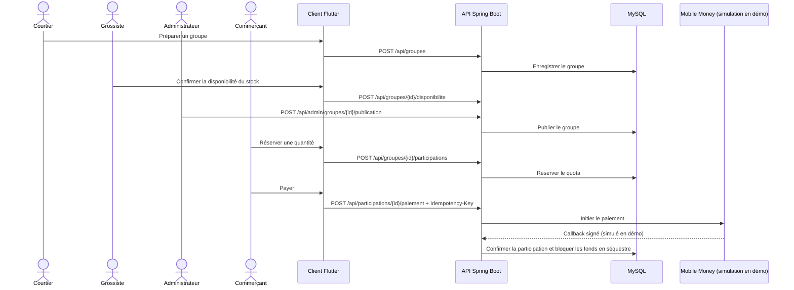
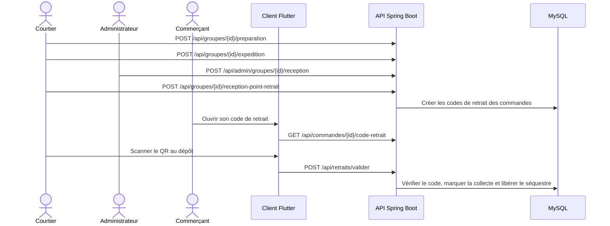

# Architecture et parcours métier

## Organisation du code

Le dépôt regroupe trois applications déployables séparément : `dogo-flutter` pour le client mobile/Web, `dogo-angular` pour la console d'administration et `dogo-backend` pour l'API. Les ressources de conception et les documents transverses restent dans `docs/`.

### Backend

Le backend est un monolithe modulaire organisé par domaine (`identite`, `catalogue`, `groupeachat`, `participation`, `finance`, `logistique`, `notification`, `audit` et `litige`). Chaque module sépare ses responsabilités en `web` (HTTP), `application` (cas d'usage), `persistence` (JPA et dépôts), `domain` (règles métier) et `api` (contrats utilisés par les autres modules), selon les besoins du domaine. `shared` contient uniquement les éléments techniques réellement communs. `ArchitectureTest` protège ces frontières et interdit les dépendances cycliques entre modules.

### Clients

Dans Flutter, `lib/<rôle>/` regroupe les parcours par acteur, `lib/services/` les accès API et services transverses, `lib/models/` les modèles partagés, `lib/widgets/` les composants communs et `lib/theme/` le thème. Les grands écrans doivent déléguer leurs composants autonomes à des fichiers dédiés; l'écran d'itinéraire suit maintenant cette règle avec ses widgets de carte et sa feuille de recherche séparés.

Dans Angular, `src/app/core/` contient l'authentification, les gardes, les intercepteurs et les clients API; `pages/` contient les écrans d'administration; `shared/` et `components/` hébergent les éléments réutilisables. Les composants d'écran ne doivent pas accéder directement au stockage backend.

Les migrations et les ressources de configuration restent dans `dogo-backend/src/main/resources/`; les tests restent près de leurs modules dans `src/test/` ou `dogo-flutter/test/`. Les données locales, secrets et sorties de compilation ne doivent pas être ajoutés à la racine du dépôt.

## Vue d'ensemble

```text
Application Flutter ─────┐
                         ├── REST/JSON ── API Spring Boot ── MySQL
Console Angular ─────────┘                    │
                                              ├── Flyway : schéma versionné
                                              ├── SMS : passerelle simulée en démo
                                              └── Mobile Money : passerelle simulée en démo
```

Le backend est un monolithe modulaire déployé comme une seule application. Les règles métier résident dans les services et les domaines du backend ; les deux clients consomment ses contrats HTTP. Le schéma et son historique sont gérés par Flyway.

Les frontières de modules et les couches sont décrites dans [dogo-backend/README.md](../dogo-backend/README.md). Les fichiers [diagramClass.xml](diagrams/diagramClass.xml) et [DiagramsUseCase.xml](diagrams/DiagramsUseCase.xml) sont des diagrammes à ouvrir avec diagrams.net.

## Création d'un groupe et paiement



## Acheminement et retrait



Les chemins ci-dessus sont ceux du contrat documenté. Les appels externes à un opérateur de paiement ou de SMS ne sont pas branchés dans le profil de démonstration.

## Vérification des modèles

- Le diagramme de classes se trouve dans `docs/diagrams/diagramClass.xml`.
- Le diagramme de cas d'utilisation se trouve dans `docs/diagrams/DiagramsUseCase.xml`.
- Les séquences ci-dessus illustrent les routes réellement documentées dans `dogo-backend/docs/API.md` et le parcours de démonstration.
- Avant une soutenance, vérifier dans diagrams.net que les diagrammes XML correspondent aux modules et aux routes actuels ; ils ne sont pas générés automatiquement depuis le code.
